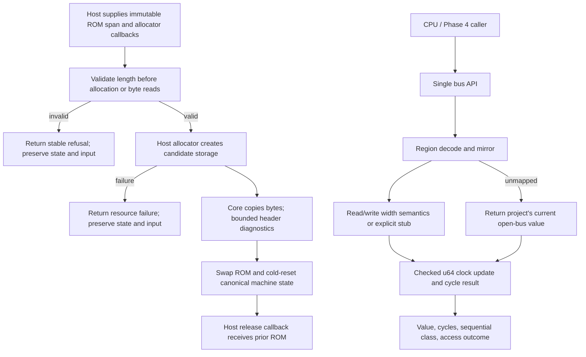

# Phase 03: Bus API, Memory Map, and ROM Loading - Research

<user_constraints>
## User Constraints (from CONTEXT.md)

### Locked Decisions

### Standing owner instructions and discussion disposition
- The owner invoked autonomous execution from Phase 3 and instructed routine,
  reversible decisions to proceed without acknowledgments. Research found no
  new material owner decision. The defaults below are agent decisions under
  that standing authority, not newly accepted owner judgments.
- Preserve Codex runtime routing and both runtime model mappings in config.
- Preserve one PR per phase, squash merge only after required CI is green;
  stop on red CI, with no ruleset bypass or repository-setting change.

### Bus and deterministic state
- Keep every memory access and internal-cycle advancement behind one bus-owned
  time authority, using a uint64_t master clock. Results expose cycle cost
  and sequential/non-sequential classification; make overflow behavior explicit.
- Use documented placeholder costs where timing is not yet implemented, labeled
  as project policy in the profile. No claim of WAITCNT or prefetch timing.
- Keep the open-bus latch explicit and testable. Phase 3 tests its simple
  unmapped-read contract; CPU-prefetch-driven latch semantics need Phase 4.
  A universal last-data-access latch is not a GBATEK hardware claim.
- Decode the documented region windows, mirrors and byte/halfword/word behavior.
  Explicitly label unimplemented I/O and device semantics; do not imply a flat
  writable I/O array models hardware. CPU misaligned load rotation is Phase 4.
- Zero-fill fresh mutable backing memory and register storage, with zero clock
  and initial latch. This is a project determinism policy; hardware power-on RAM
  contents remain unknown. CPU direct-start registers are a Phase 4 decision.
- Cite GBATEK 3.06 sections per decode case. Do not reuse 2.9b-derived claims.

### Loader ownership and refusal behavior
- Validate lengths before allocation, reads or mutation: zero, below 0xC0,
  over 32 MiB, odd. Give distinct stable reasons; define overlap precedence.
- Copy the caller's ROM. On a successful second load, atomically replace the
  ROM and reset machine state to documented cold-start defaults. Prepare the
  new image before releasing the old one. Refusal and allocation failure leave
  the existing ROM, state, and caller input unchanged.
- Keep resource failure distinct from malformed input. Use bounded result
  fields, avoiding caller diagnostic-buffer mutation on refusal.
- Preserve the freestanding core gate. Allocation or storage provisioning must
  stay explicit at the host boundary; do not introduce host heap/file APIs.
- Compare canonical state fields and arrays, excluding padding and pointer
  identities, for full-state refusal evidence. Prove refusal on already-loaded,
  non-default state as well as fresh state.

### Header findings and the existing logo gate
- Under direct-start, logo, checksum and unusual game-code findings are advisory;
  they never refuse an otherwise size-valid image. Do not embed Nintendo bytes.
- The real logo digest remains owner-pending. Do not obtain or manufacture a
  canonical replacement. Report an explicit unchecked/unverified reason when
  canonical comparison cannot run. An all-zero window may be labeled missing
  by documented project convention; other content is not thereby a match.
- Synthetic test-only expected windows may prove comparison paths, including
  mismatch. They cannot establish comparison against the real Nintendo logo.
- LOAD-02 remains partial for canonical logo mismatch detection until the owner
  supplies the digest. Keep that acceptance gap visible in verification; do not
  silently narrow the requirement or mark all phase criteria passed.
- Header checksum and bounded game-code diagnostics proceed independently.

### the agent's Discretion
Exact internal layouts, minimal lifecycle API shape without a stable ABI promise,
allocation/storage mechanism consistent with the purity gate, function and reason
names, test decomposition, placeholder table values and explicit I/O limits.
Do not add dependencies or expose the final consumer/package API prematurely.

### Deferred Ideas (OUT OF SCOPE)
- Real-logo canonical comparison: existing owner-pending digest gate; owner acts.
- CPU execution, banked registers, pipeline fetch/latch integration: Phase 4.
- WAITCNT, prefetch, BIOS protection and active devices: later milestone work.
- Stable embedding API, packaging and installed consumers: later roadmap.
- Phase 1 verification is reported stale after later source changes; refresh
  before milestone close rather than treating the historical pass as current.
</user_constraints>

**Researched:** 2026-11-10  
**Domain:** C17 GBA machine bus, memory map, deterministic state, and ROM loading  
**Confidence:** MEDIUM

## Phase Requirements

Requirement text is copied from `.planning/REQUIREMENTS.md:48-57`:

| ID | Description | Research Support |
|----|-------------|------------------|
| BUS-01 | “Every CPU memory access goes through a bus API that returns its cycle cost and its sequential/non-sequential class, and advances one `u64` master clock in 16,777,216 Hz cycles. Placeholder costs are allowed, but the API is final.” | Central bus API, one clock owner, checked cycle addition, profile-labelled placeholder table. |
| BUS-02 | “The bus decodes the full GBA memory map (BIOS, EWRAM, IWRAM, I/O, PRAM, VRAM, OAM, Game Pak ROM) with documented mirrors and width rules, and unmapped reads return the open-bus value.” | Region/mirror/width map below; separates mapped-but-unimplemented I/O from unmapped addresses. |
| BUS-03 | “Power-on memory and register contents are filled deterministically according to a documented, profile-recorded policy.” | Explicit zero-fill policy, cold reset, and canonical-state comparison excluding padding and pointers. |
| LOAD-01 | “The core copies a ROM image on load and validates its length (zero, below header size, above 32 MiB, odd length are distinct refusals) before allocation or state mutation.” | Precedence, host allocation boundary, safe copy-and-swap flow, allocation-failure path. |
| LOAD-02 | “Header findings (logo, checksum, game code) are reported as loader diagnostics, not refusals, under `direct-start`.” | Bounded header parse and advisory diagnostics; canonical logo result remains gated by owner digest. |
| LOAD-03 | “A refused load leaves the instance state and caller buffers byte-identical to before the call, verified by test.” | Failure atomicity and per-field/array state comparison tests. |

## Summary

Use one final internal bus API to own address decoding and the `uint64_t` guest clock. Keep raw bus address/width behavior separate from CPU instruction alignment; choose a simple, explicitly project-labelled placeholder cost table, return the requested sequential class, and check clock overflow before any read/write side effect. GBATEK documents the map and access widths, but its unused-memory behavior depends on prefetched CPU opcodes; the phase's current-latch response is intentionally a project placeholder pending Phase 4 pipeline state. [CITED: GBATEK 3.06, “Address Bus Width and CPU Read/Write Access Widths,” “Reading from Unused Memory”](https://mgba-emu.github.io/gbatek/)

The ROM loader should validate the length before calling the host allocator or reading any image byte, copy into a separately allocated candidate, parse only bounded header spans, then atomically swap the ROM and cold-reset machine state. Allocation failure and each refusal preserve the prior instance and caller buffer. Do not conflate the Game Pak's three wait-state aliases with modulo mirroring by the shorter loaded image length: GBATEK documents the former, while the consulted sections do not settle reads beyond an image's actual length. [CITED: GBATEK 3.06, “GBA System Control,” “Memory Mirrors,” “GBA Cartridge ROM”](https://mgba-emu.github.io/gbatek/)

**Primary recommendation:** Implement the bus as the only clock authority, model each documented physical mirror explicitly, and provide host allocator callbacks for transactional ROM replacement; record all not-yet-hardware timing/read behavior as project policy. Keep LOAD-02 visibly partial while the real-logo digest is owner-pending.

## Architectural Responsibility Map

| Capability | Primary Tier | Secondary Tier | Rationale |
|------------|-------------|----------------|-----------|
| Address decode, read/write width semantics, guest clock | API / Backend | — | This is deterministic machine behavior and belongs in the canonical C core, not a host adapter. |
| ROM input ownership and replacement | API / Backend | Host adapter | Core validates/copies/swaps; host owns allocation and release callbacks. |
| ROM file selection and filesystem access | Host adapter | — | File paths and file reads remain outside the host-independent core. |
| Profile and executable checks | Build / Test tooling | Core | Tests and profile validators assert declared policy without adding runtime dependencies. |

## Standard Stack

### Core

| Library / Tool | Version | Purpose | Why Standard |
|---------------|---------|---------|--------------|
| C | C17 | Portable machine core and small host-facing API | Repository sets `CMAKE_C_STANDARD 17`, requires it, and disables compiler extensions. Exact source: `CMakeLists.txt:13-15`: `set(CMAKE_C_STANDARD 17)`, `set(CMAKE_C_STANDARD_REQUIRED ON)`, `set(CMAKE_C_EXTENSIONS OFF)`. [VERIFIED: CMakeLists.txt:13-15] |
| CMake + CTest | Existing project floor 3.25 | Build, test registration, and canonical verification workflow | The existing project uses CMake/CTest and has a single verification workflow. Exact source: `CMakeLists.txt:34-38`: `#   cmake --workflow --preset ci`; `CMakePresets.json:101-109` runs configure, build, tests, and post-inventory check. [VERIFIED: CMakeLists.txt:34-38; CMakePresets.json:101-109] |
| Freestanding C headers | `stddef.h`, `stdint.h`, `stdbool.h`, `limits.h` | Size, fixed-width integer, boolean, and limit types in core | The include gate permits only these system headers. Exact source: `cmake/CheckCoreIncludes.cmake:28`: `set(GBL_FREESTANDING_HEADERS stddef.h stdint.h stdbool.h limits.h)`. [VERIFIED: cmake/CheckCoreIncludes.cmake:28] |

### Supporting

No external packages are needed for this phase. Reuse the existing static core, CTest, profile validator, and ASan/UBSan lanes; add no runtime dependency. The current profile source identifies `schema` as `gamebloke.profile/1`, `id` and `machine` as `agb`, `boot` as `direct-start`, `bios_provider` as `none`, and cart `kind` as `rom-only` (`profiles/agb.json:2-8`, quoted verbatim here). [VERIFIED: profiles/agb.json:2-8]

**Installation:** None.

## Project Constraints (from AGENTS.md)

- Keep machine behavior deterministic and separate from host files/clocks and presentation. Source quote: “Keep deterministic machine behavior separate from host clocks, files, physical controller discovery and mapping, windowing, audio/video presentation, persistent file writes, and multiplayer transport.” [VERIFIED: AGENTS.md:25-27]
- Keep dependencies small and justified; do not add any for this phase. Source quote: “Prefer a small, flat dependency tree.” [VERIFIED: AGENTS.md:31-34]
- Do not add commercial ROMs, BIOS bytes, private saves, credentials, or unlicensed fixtures. Source quote: “Do not put commercial game ROMs, Nintendo BIOS bytes, private saves, credentials, or unlicensed test content in source control or public CI.” [VERIFIED: AGENTS.md:35-39]
- Tie claims to exact profile and evidence; this phase does not qualify hardware accuracy. Source quote: “Describe accuracy and compatibility by exact machine, BIOS mode, cartridge and save device, optional peripheral, and test evidence.” [VERIFIED: AGENTS.md:40-43]
- Preserve one canonical command and negative controls; skipped or missing tests must remain visible. Source quote: “Maintain one canonical local command aligned with the fast required CI path. Give important gates a meaningful negative control; missing and skipped checks must be visible.” [VERIFIED: AGENTS.md:77-80]
- Use fresh deterministic state and semantic assertions as well as byte comparisons. Hashes alone show repeatability, not correctness. [VERIFIED: AGENTS.md:81-85]
- Do not copy implementation code from GPL NanoBoyAdvance or MPL mGBA; use those projects only for behavior comparisons. [VERIFIED: .planning/ROADMAP.md:149-151]

## Architecture Patterns

### System Architecture Diagram



### Recommended Project Structure

Recommended split (new filenames are planning suggestions, `[ASSUMED]`):

```text
include/gamebloke/gamebloke.h  # lifecycle and bus/loader declarations; no stable ABI promise
src/machine.c                  # canonical state initialization and cold reset
src/bus.c                      # decode, region mirrors, width rules, clock authority
src/loader.c                   # validation, host allocator boundary, copy/swap, diagnostics
tests/bus_test.c               # decode, mirror, width, cycle, overflow, and open-bus cases
tests/loader_test.c            # validation, transactional failure, copy ownership, diagnostics
tests/core.cmake                # register executable tests in existing lanes
tests/inventory/ci.txt          # sorted expected test inventory
tests/inventory/asan.txt        # sorted ASan expected test inventory
```

Keep the core declarations minimal for Phase 3; lifecycle shape can be finalized internally without committing to the later public package/consumer API. Add core sources to `gamebloke_core`, register tests through `tests/core.cmake`, and update both sorted lane inventories. The current CMake core is a static library containing only `src/version.c` (`CMakeLists.txt:43-50`). [VERIFIED: CMakeLists.txt:43-50]

### Pattern 1: One bus clock authority

**What:** Each raw read, write, and explicit internal-cycle advancement enters one API. It returns a cycle cost and sequential/non-sequential class; it advances the sole `uint64_t` master-cycle count. Region handlers return effects/cost inputs and never update time themselves. The profile's master clock is already labeled REF as 16,777,216 Hz (`profiles/agb.json:9-14`). Exact quote: `"master_clock_hz": {` / `"value": 16777216,` / `"source": "REF",`. [VERIFIED: profiles/agb.json:9-14]

**Timing policy:** Use an explicit placeholder cost matrix, initially one master cycle per raw bus request for all regions, access widths, and sequence classes; retain and report the sequence class even though the placeholder does not yet vary by it. Store it as project policy (`IMPL`), not a GBATEK `REF` claim. Replace values only when profile-supported timing work lands. `[ASSUMED]` This flat placeholder is the smallest explicit reversible policy; risk if wrong is that Phase 4 diagnostics depend on provisional timing. It is not hardware accuracy or WAITCNT/prefetch timing.

**Overflow policy:** Before a handler mutates data or a read updates any observable latch, check `cost <= UINT64_MAX - master_cycles`. On overflow, return a distinct time-overflow outcome and leave clock, memory, latch, and result state unchanged. Apply the same check to explicit internal cycles. `[ASSUMED]` This failure-atomic policy preserves monotonic guest time and avoids wraparound.

### Pattern 2: Explicit physical region mapping

GBATEK 3.06 identifies the GBA windows, backing sizes, internal mirrors, width support, and special video byte-store behavior. Those are reference observations, not physical qualification; test each mapping independently. [CITED: GBATEK 3.06, “GBA Memory Map,” “Memory Mirrors,” “Address Bus Width and CPU Read/Write Access Widths,” “Writing 8bit Data to Video Memory”](https://mgba-emu.github.io/gbatek/)

| CPU address window | Backing / mirror rule | Raw widths and handling |
|--------------------|-----------------------|-------------------------|
| `0x00000000–0x00003FFF` BIOS | 16 KiB mapped region; GBATEK says BIOS does not mirror. The current profile has `bios_provider` `none`; model the region as absent/unprovided rather than inserting Nintendo BIOS bytes. [CITED: “GBA Memory Map,” “Memory Mirrors”](https://mgba-emu.github.io/gbatek/) | Read/write widths in reference are 8/16/32 reads and no writes. With no provider and no CPU pipeline, choose and label a deterministic placeholder read policy; recommended: return current open-bus value and ignore writes. This is not BIOS protection emulation. `[ASSUMED]` |
| `0x02000000–0x02FFFFFF` EWRAM | 256 KiB backing, repeated at 256 KiB stride within the 16 MiB block. [CITED: “GBA Memory Map,” “Memory Mirrors”](https://mgba-emu.github.io/gbatek/) | Read/write 8/16/32; reference bus is 16-bit. Assemble/disassemble little-endian bytes without host alignment assumptions. [CITED: “Address Bus Width and CPU Read/Write Access Widths”](https://mgba-emu.github.io/gbatek/) |
| `0x03000000–0x03FFFFFF` IWRAM | 32 KiB backing, repeated at 32 KiB stride within the 16 MiB block. [CITED: “GBA Memory Map,” “Memory Mirrors”](https://mgba-emu.github.io/gbatek/) | Read/write 8/16/32; reference bus is 32-bit. [CITED: “Address Bus Width and CPU Read/Write Access Widths”](https://mgba-emu.github.io/gbatek/) |
| `0x04000000–0x040003FE` I/O | Address-decode the register window, but do not present an undifferentiated writable byte array as modeled hardware. Unsupported register semantics must be visible. There is a special undocumented `0x04000800` port mirrored each 64 KiB; defer its behavior and retain the profile's SP/Micro qualification limit. [CITED: “GBA Memory Map,” “Memory Mirrors,” “Internal Memory Control”](https://mgba-emu.github.io/gbatek/) | Reference lists 8/16/32 read/write widths at the CPU bus interface; actual effects are register-specific. Recommended placeholder: unsupported reads return open bus and unsupported writes are ignored, with a distinct access outcome. `[ASSUMED]` |
| `0x05000000–0x05FFFFFF` PRAM / palette | 1 KiB backing mirrored at 1 KiB stride in the 16 MiB block. [CITED: “GBA Memory Map,” “Memory Mirrors”](https://mgba-emu.github.io/gbatek/) | Reads 8/16/32; writes 16/32 normally. An 8-bit store duplicates the byte into both lanes of the containing halfword. Reference bus is 16-bit. [CITED: “Address Bus Width and CPU Read/Write Access Widths,” “Writing 8bit Data to Video Memory”](https://mgba-emu.github.io/gbatek/) |
| `0x06000000–0x06FFFFFF` VRAM | 96 KiB physical backing. The mirror period is 128 KiB: bytes in the last 32 KiB of each period alias the preceding OBJ 32 KiB; repeat the 128 KiB pattern across the 16 MiB block. [CITED: “GBA Memory Map,” “Memory Mirrors”](https://mgba-emu.github.io/gbatek/) | Reads 8/16/32; writes 16/32 normally. **Mode-sensitive byte stores:** BG bytes duplicate into both halfword lanes; OBJ byte stores are ignored. In BG modes 0–2 the OBJ window is `0x06010000–0x06017FFF`; in bitmap modes 3–5 it shifts to `0x06014000–0x06017FFF`. Do not globally ignore all VRAM byte writes. [CITED: “LCD VRAM Overview,” “LCD I/O Display Control,” “Writing 8bit Data to Video Memory”](https://mgba-emu.github.io/gbatek/) |
| `0x07000000–0x07FFFFFF` OAM | 1 KiB backing mirrored at 1 KiB stride within the 16 MiB block. [CITED: “GBA Memory Map,” “Memory Mirrors”](https://mgba-emu.github.io/gbatek/) | Reads 8/16/32; writes 16/32; byte writes ignored. Reference bus is 32-bit. [CITED: “Address Bus Width and CPU Read/Write Access Widths,” “Writing 8bit Data to Video Memory”](https://mgba-emu.github.io/gbatek/) |
| `0x08000000–0x0DFFFFFF` Game Pak ROM | Three 32 MiB windows at `0x08000000`, `0x0A000000`, and `0x0C000000` alias the same Game Pak ROM for wait states 0–2. This alias is by address window, not by loaded image length. Writes are unsupported for the ROM-only profile. [CITED: “GBA Memory Map,” “GBA System Control,” “Memory Mirrors”](https://mgba-emu.github.io/gbatek/) | Reads 8/16/32 from a 16-bit bus. `[CITED: “Address Bus Width and CPU Read/Write Access Widths”](https://mgba-emu.github.io/gbatek/)` |
| `0x04000400–0x04FFFFFF`, `0x0E000000–0x0FFFFFFF`, and all other unmatched addresses | Unmapped for this ROM-only v1 profile; SRAM/backup devices remain unmodeled. GBATEK says most such reads return prefetched-opcode fragments, which require CPU state. [CITED: “GBA Memory Map,” “Reading from Unused Memory”](https://mgba-emu.github.io/gbatek/) | Phase 3's current-latch response is project policy from CONTEXT, not a universal hardware rule. Classify unsupported mapped I/O separately from wholly unmapped addresses. |

The three wait-state windows are explicitly called mirrored in GBATEK, while its `Memory Mirrors` section says normal ROM cartridges themselves are not mirrored. The consulted GBA cartridge sections do **not** specify what a shorter image's tail returns. Therefore do not apply `offset % rom_length`; keep offsets relative to each 32 MiB window, return an explicit deterministic out-of-image policy (recommended: current open-bus value), and label it unverified project behavior. A conclusive physical value remains unknown. [CITED: GBATEK 3.06, “GBA System Control,” “Memory Mirrors,” “GBA Cartridge ROM”](https://mgba-emu.github.io/gbatek/)

**Raw bus vs CPU alignment:** Preserve the exact address and requested width at this layer. The CPU adapter later implements ARM7TDMI misaligned word rotation/byte masking; GBATEK describes rotation at the CPU read behavior. Do not align addresses in the bus as a shortcut. [CITED: GBATEK 3.06, “Reading from Unused or Write-Only I/O Ports”; Phase 4 boundary in `03-CONTEXT.md`]

**VRAM mode dependency:** Byte-store classification needs the current BG mode because the OBJ window moves between tile modes and bitmap modes. Recommendation: let the bus consult only the low BG-mode bits from a minimal bus-visible `DISPCNT` state, or an internal mode field used by tests; leave PPU rendering and all other I/O effects unimplemented. Do not use a fixed OBJ boundary. `[ASSUMED]` The minimal mode field preserves the reference behavior without claiming a PPU implementation.

### Pattern 3: Transactional copy-on-load

**What:** Keep allocation outside the core's host-independent implementation through caller-supplied allocate/release callbacks. Core validates size before calling allocate or dereferencing the ROM span; it prepares a distinct candidate, copies without relying on `memcpy`, derives local bounded diagnostics, then commits pointer/length/diagnostics and resets cold state. Only after commit does it hand the old allocation to the release callback. Require candidate storage not to overlap the active ROM or immutable input. `[ASSUMED]` Callback names/layout are internal suggestions; callbacks are the smallest flexible explicit boundary that supports failure atomicity without core `malloc`.

Suggested validation order: zero length; shorter than the 192-byte header (`0xC0`); greater than 32 MiB (`0x02000000`); odd length. This resolves overlap deterministically: zero wins over undersized, undersized over odd, and oversized over odd. The first 192 bytes contain the cartridge header; header fields include the 156-byte logo at offset `0x04`, game code at `0xAC`, and complement checksum at `0xBD`. [CITED: GBATEK 3.06, “GBA Cartridge Header”](https://mgba-emu.github.io/gbatek/)

Return refusal/resource status by value or in immutable-by-caller interface state; do not write caller diagnostic buffers on refusal. On success, store bounded diagnostics in the instance. The GBATEK checksum procedure is a bounded byte subtraction over header bytes `0xA0..0xBC` with the `0x19` adjustment; game code should be copied into a fixed-size field and checked against a documented project allowlist/convention, not assumed valid from title or filename. Header findings remain advisory under `direct-start`. [CITED: GBATEK 3.06, “GBA Cartridge Header”](https://mgba-emu.github.io/gbatek/)

```text
status = validate_length(length)       // no image read and no allocation yet
if refused: return status
candidate = host_allocate(length)
if candidate unavailable: return resource_failure
copy candidate[0..length) from immutable input
diagnostics = parse_bounded_header(candidate, length)
old = commit_rom_and_cold_reset(instance, candidate, length, diagnostics)
host_release(old)
return success
```

This is original pseudocode, not copied emulator code. Candidate preparation must not mutate the old instance; allocation failure and invalid lengths return before caller bytes or canonical state change.

### Pattern 4: Explicit deterministic initialization

Zero every mutable backing array, register field, latch, and clock explicitly at create/reset; avoid relying on struct padding, static/global state, or `memset` from a forbidden header. Keep BIOS and ROM bytes outside zero-filled mutable RAM. This is a project repeatability policy only; the project source itself records RAM power-on contents as unknown. Compare fields and arrays, not raw `sizeof(struct)` bytes or pointer identity. [CITED: `.planning/ROADMAP.md:145-150`, `03-CONTEXT.md`]

### Anti-Patterns to Avoid

- **Flat writable I/O RAM:** It turns unimplemented device behavior into a false hardware claim. Decode the I/O range but explicitly report supported registers and stub the rest.
- **Modulo by actual ROM length:** It confuses a documented wait-state window alias with an unsupported claim about a smaller cartridge's address lines; keep the tail policy explicit and bounded.
- **One generic VRAM byte-store rule:** BG and palette byte writes duplicate the value, while OBJ/OAM byte writes are ignored; OBJ placement changes in bitmap modes.
- **CPU fixups inside the bus:** Misaligned ARM load rotation belongs to the CPU adapter; bus tests should see the raw address and width.
- **Allocate/copy into active ROM then validate:** Any refusal or allocation error would corrupt already-loaded state. Allocate a separate candidate and commit only after all failure-prone work.
- **`malloc`, `free`, `memcpy`, or host headers in core:** The core purity gate only permits four freestanding headers; use host-supplied allocator callbacks and a small copy loop.
- **Treat zero-fill as hardware power-on evidence:** It is deterministic project policy; actual RAM power-on values are unknown.
- **License-derived implementation copying:** Read mGBA/NanoBoyAdvance behavior only; do not copy their MPL/GPL code. [CITED: `.planning/ROADMAP.md:149-151`]

## Don't Hand-Roll

| Problem | Don't Build | Use Instead | Why |
|---------|-------------|-------------|-----|
| Host memory allocation | A hidden core heap, static 32 MiB ROM slab, or file API | Explicit host-provided allocate/release callbacks; core only validates/copies/swaps | Satisfies the project purity boundary while allowing allocation failure without mutation. |
| Header comparison oracle | A copied/canonical Nintendo logo byte array or invented digest | Owner-provided digest gate; synthetic test windows only for comparison algorithm paths | No permission or expected digest may be inferred from another source; a digest identifies bytes but not rights. |
| Hardware timing | New handwritten wait-state/prefetch model in this phase | Profile-labelled project placeholder table; defer WAITCNT/prefetch | Those behaviors are explicitly out of scope for this phase. |
| ROM backup device detection | Filename/title heuristics or generic SRAM implementation | Keep profile cart ROM-only and report backup unmodeled | Backup-media support is a later profile requirement. |
| Test framework | New third-party unit-test dependency | Existing small `tests/check.h` checks and CTest integration | Fits the flat dependency policy and current CI lanes. |

## Common Pitfalls

### Pitfall 1: Mistaking ROM address aliases for image-length mirrors
**What goes wrong:** Reads in wait-state 1/2 work, then every address after a short image wraps to the beginning.  
**Why it happens:** The three 32 MiB wait-state windows are mistaken for evidence that a 4/8 MiB image repeats inside a window.  
**How to avoid:** Alias the three windows to the same offset; use a checked `offset < rom_length` branch. For the tail, use an explicit placeholder such as current open bus and mark physical behavior unresolved.  
**Warning signs:** `rom_offset % rom_length`, OOB access, or test fixtures that only contain a full 32 MiB synthetic image. GBATEK describes three region aliases but does not settle the shorter-image tail. [CITED: GBATEK 3.06, “GBA System Control,” “Memory Mirrors,” “GBA Cartridge ROM”](https://mgba-emu.github.io/gbatek/)

### Pitfall 2: Incorrect video byte stores
**What goes wrong:** All VRAM byte writes are ignored, or byte writes to OBJ mutate tile data.  
**How to avoid:** Test BG mode 0 and bitmap mode 3 separately at the OBJ boundary; test BG/PRAM replication and OBJ/OAM ignored writes. The OBJ window changes from `0x06010000` to `0x06014000` for bitmap modes. [CITED: GBATEK 3.06, “Writing 8bit Data to Video Memory,” “LCD VRAM Overview”](https://mgba-emu.github.io/gbatek/)

### Pitfall 3: Treating a mapped-but-unimplemented I/O register as ordinary RAM
**What goes wrong:** Reads/writes appear to work, and tests silently imply device semantics that are not implemented.  
**How to avoid:** Keep I/O address decoding separate from register behavior; record unsupported semantics and test the chosen project stub. GBATEK unused I/O can depend on opcode prefetch, which is deferred to Phase 4. [CITED: GBATEK 3.06, “Reading from Unused or Write-Only I/O Ports”](https://mgba-emu.github.io/gbatek/)

### Pitfall 4: Failure after mutating active state
**What goes wrong:** Bad size or allocator failure leaves a partially overwritten old ROM, reset clock, changed state, or changed caller buffer.  
**How to avoid:** Validate precedence, allocate/copy/parse into separate candidate state, then commit. On every refusal and allocation failure compare all canonical fields/arrays plus source bytes on both fresh and non-default already-loaded instances.

### Pitfall 5: Claiming a logo pass without the real expected digest
**What goes wrong:** A synthetic test passes, or an all-zero window is labeled missing, and LOAD-02 is reported fully verified.  
**How to avoid:** Synthetic windows establish only comparison mechanics. The owner-pending digest must remain explicit; no logo bytes or replacement digest may be embedded. The state file records the digest as `owner-pending (human-needed)` and says the owner must supply it from a file they hold. Exact quote: “the real-logo digest (EVID-04) is `owner-pending (human-needed)`.” [VERIFIED: .planning/STATE.md:138]

## Code Examples

### Checked clock before side effects

```c
/* Illustrative internal pattern; names are not an ABI. */
if (cycles > UINT64_MAX - machine->master_cycles) {
    return time_overflow_without_mutation();
}
/* Only after the overflow check: perform region effect and commit new time. */
```

`uint64_t` comes from the permitted freestanding header list. The no-mutation overflow behavior is a recommendation (`[ASSUMED]`), chosen so the clock cannot silently wrap.

### Byte-store semantics for video memory

```text
if target is BG VRAM or palette: write (byte * 0x0101) to aligned halfword
if target is OBJ VRAM or OAM: ignore the byte store
```

The BG/OBJ target classification depends on the display BG mode because the OBJ base moves in bitmap modes. Source: [GBATEK 3.06, “Writing 8bit Data to Video Memory”](https://mgba-emu.github.io/gbatek/).

## State of the Art

| Old Approach | Current Recommendation | When Changed | Impact |
|--------------|------------------------|--------------|--------|
| Assume every unused read is zero, or treat the open-bus latch as the last data word | Keep CPU prefetch-dependent unused reads deferred; use only the agreed current-latch project placeholder in Phase 3 | This phase / Phase 4 boundary | Prevents the minimal bus from claiming CPU pipeline behavior. [CITED: GBATEK 3.06, “Reading from Unused Memory”](https://mgba-emu.github.io/gbatek/) |
| Treat a ROM's size as a mirror period | Keep image-tail behavior explicitly unresolved; do not modulo by loaded image size | No hardware evidence located in the consulted GBATEK sections | Prevents address-window aliasing from being misapplied to content bounds. [CITED: GBATEK 3.06, “Memory Mirrors,” “GBA Cartridge ROM”](https://mgba-emu.github.io/gbatek/) |

## Assumptions Log

| # | Claim / Recommendation | Section | Risk if Wrong |
|---|------------------------|---------|---------------|
| A1 | `[ASSUMED]` Use host-provided allocation/release callbacks so core can allocate only after validating, prepare a replacement ROM, and atomically swap. | Pattern 3 | Callback contract has to specify ownership, non-overlap, and release timing. |
| A2 | `[ASSUMED]` Use a flat one-cycle-per-request placeholder until region timing is modeled. | Pattern 1 | Early CPU diagnostics may depend on an arbitrary temporary cost; profile must mark it IMPL. |
| A3 | `[ASSUMED]` Return current open bus for ROM image tail and absent BIOS / unsupported I/O reads during this phase. | Patterns 2–3 | This does not establish physical cartridge, BIOS, or I/O behavior; replace only with evidence. |
| A4 | `[ASSUMED]` Make `DISPCNT` BG mode available to bus classification without implementing the PPU. | Pattern 2 | Slightly expands bus state but is needed to apply mode-dependent OBJ byte-write rules. |
| A5 | `[ASSUMED]` Reject overlapping length violations in order zero, under-header, oversized, odd. | Pattern 3 | Stable reason precedence is a new internal contract; tests and diagnostics must use the same order. |

## Open Questions

1. **What do hardware reads return above a shorter ROM image's actual size?** GBATEK identifies the three wait-state aliases and says normal ROM cartridges are not mirrored, but does not specify this image-tail case. Recommendation: keep no-modulo behavior and use the current open-bus placeholder pending authoritative or hardware evidence. No physical claim can be made from the current reference set.
2. **What is the real Nintendo-logo comparison result?** The owner digest is pending. Preserve LOAD-02 as partial for canonical logo mismatch until the owner supplies it; synthetic expected bytes prove only the comparison path.
3. **What exact values go in the placeholder timing table?** CONTEXT leaves these to agent discretion. Recommendation above is one cycle per raw request and all cells labeled project `IMPL`, with no WAITCNT/prefetch claim.

## Environment Availability

| Dependency | Required By | Available | Version | Fallback |
|------------|-------------|-----------|---------|----------|
| CMake | canonical build and test workflow | ✓ | 4.4.3 (local probe) | — |
| Ninja | existing CMake presets | ✓ | 1.13.2 (local probe) | use project-configured generator |
| C compiler | C17 build | ✓ | Apple Clang 21 (local probe) | CI also configures GCC on Linux |
| `clang-21` executable | existing ASan preset | ✗ | — | configure local ASan preset with installed `clang`, or use CI ASan lane |

The local executable/version data above came from `command -v` and `--version` probes. No package install or test execution was performed during research.

## Validation Architecture

### Test Framework

| Property | Value |
|----------|-------|
| Framework | CTest plus in-tree `tests/check.h`; no external unit-test framework. [`tests/check.h:1-4`] |
| Config file | `CMakePresets.json`; CMake test registration lives in `tests/core.cmake`. [`CMakePresets.json:47-110`; `tests/core.cmake:1-18`] |
| Quick run command | `cmake --workflow --preset ci` (repo's canonical command). [`CMakeLists.txt:34-38`] |
| Full suite command | `cmake --workflow --preset ci`; CI uses the same required check on Linux GCC and macOS arm64. [`AGENTS.md:77-80`; `.planning/REQUIREMENTS.md:48-57`] |

### Phase Requirements → Test Map

| Req ID | Behavior | Test Type | Automated Command | File Exists? |
|--------|----------|-----------|-------------------|-------------|
| BUS-01 | Access result has cost/class and advances only the central clock; overflow refuses before any side effect. | unit | `ctest --test-dir build/ci -R '^bus\.' --output-on-failure` | No — add C executable and register in `tests/core.cmake`. |
| BUS-02 | Every mapped boundary, mirror, width rule, video byte-store case, unsupported I/O stub, and open-bus case behaves as declared. | unit | `ctest --test-dir build/ci -R '^bus\.' --output-on-failure` | No — add. |
| BUS-03 | Fresh instance and reset produce identical zero-fill state, clock, and latch. | unit | `ctest --test-dir build/ci -R '^machine\.' --output-on-failure` | No — add. |
| LOAD-01 | Length refusals have distinct stable reasons; invalid lengths do not allocate/read; success copies immutable caller data. | unit | `ctest --test-dir build/ci -R '^loader\.' --output-on-failure` | No — add. |
| LOAD-02 | Bounded logo/checksum/game-code diagnostics are advisory; missing canonical logo digest is reported unverified. | unit | `ctest --test-dir build/ci -R '^loader\.' --output-on-failure` | No — add synthetic fixtures only. |
| LOAD-03 | Refusal and allocation failure leave loaded non-default state and caller bytes unchanged. | unit | `ctest --test-dir build/ci -R '^loader\.' --output-on-failure` | No — add. |

### Sampling Rate

- Per task and wave: run the focused CTest case, then the lane workflow.
- Phase gate: `cmake --workflow --preset ci`; also run the existing ASan/UBSan lane when available. `ctest` alone is not the canonical verify command because the workflow runs its post-step test inventory check. [`CMakeLists.txt:34-38`; `CMakePresets.json:101-109`]

### Wave 0 Gaps

- [ ] Add `bus_test.c` and `loader_test.c` executables and register them in `tests/core.cmake`.
- [ ] Update sorted inventories for CI and ASan; inventory gate must fail if a test is missing or silently skipped.
- [ ] Extend the profile JSON, narrative, and validator together for the bus timing placeholder table; preserve the existing source labels and require every claim-affecting value to have an explicit project-policy provenance.
- [ ] Add useful negative controls: (a) a deliberate wrong EWRAM/IWRAM/VRAM mirror mask fails a boundary test; (b) ignored OBJ/OAM byte writes or BG/PRAM replication reversed fails their paired cases; (c) allocation invoked for invalid size fails an expect-fail mutation; (d) allocator failure or each invalid length changes any canonical field/input byte fails. Keep synthetic ROM data in tests only.
- [ ] Add a control proving a synthetic logo comparison can pass/mismatch, while canonical comparison without owner digest remains explicitly unchecked/partial rather than PASS.

## Security Domain

Current OWASP ASVS stable release is 5.0.0 (published 2025-05-30); its relevant chapters are V1 Encoding and Sanitization, V2 Validation and Business Logic, V5 File Handling, V6 Authentication, V8 Authorization, and V11 Cryptography. This is a local deterministic library, not a web application, so only input validation, memory/range safety, file-content handling at the host boundary, and transactional state behavior materially apply. [CITED: OWASP ASVS 5.0.0 overview](https://asvs.owasp.org/), [ASVS 5.0.0 requirement CSV](https://github.com/OWASP/ASVS/blob/master/5.0/docs_en/OWASP_Application_Security_Verification_Standard_5.0.0_en.csv)

| ASVS 5.0 category | Applies | Control for this phase |
|-------------------|---------|------------------------|
| V1 Encoding and Sanitization — memory/string/integer safety | Yes | Validate length before allocation/read; bounded pointer arithmetic; no overflow; copy only validated span; no unbounded diagnostics. |
| V2 Validation and Business Logic | Yes | Document exact size rules and precedence; refusal and allocation failure preserve full state/input. |
| V5 File Handling | Yes at host boundary | Host reads files; core accepts only a bounded byte span and must not open paths itself. |
| V6 Authentication | No | No users, accounts, or authentication in this library phase. |
| V8 Authorization | No | No remote service or multi-user authorization boundary. |
| V11 Cryptography | No new cryptography | ROM logo digest belongs to the existing rights/evidence gate; do not invent expected bytes or treat a digest as permission. |

### Known Threat Patterns

| Pattern | STRIDE | Standard Mitigation |
|---------|--------|---------------------|
| Malformed or oversized ROM length causes OOB read / allocation blowup | Tampering / Denial of Service | Validate range and parity before any allocation or byte read; cap at 32 MiB; distinguish allocator failure; use sanitizers. |
| Arithmetic wrap in clock/address offset | Tampering | Checked addition and bounded offsets before state effects; UBSan lane. |
| Failed load corrupts old machine state | Tampering / Denial of Service | Candidate buffer and local diagnostics; commit only after success; full semantic-state and source-buffer comparison. |
| ROM bytes or titles echoed in diagnostics/logs | Information Disclosure | Report field offsets and bounded codes only; never dump input content. |
| Test fixture rights inferred from a matching digest | Repudiation | Keep fixture provenance and license separate; no copyrighted ROM/logo/BIOS bytes in repository or CI. |

## Sources

### Reference source (MEDIUM confidence)

- [GBATEK Markdown fork](https://mgba-emu.github.io/gbatek/) — identifies itself as extracted from no$gba version 3.06. Sections checked: GBA Memory Map; Address Bus Width and CPU Read/Write Access Widths; Reading from BIOS/Unused Memory; Memory Mirrors; Writing 8bit Data to Video Memory; LCD VRAM Overview and Display Control; GBA System Control WAITCNT; GBA Cartridge Header; GBA Cartridge ROM. This is a community hardware reference, not Nintendo documentation or physical qualification.
- [OWASP ASVS 5.0.0](https://asvs.owasp.org/) and [official requirement CSV](https://github.com/OWASP/ASVS/blob/master/5.0/docs_en/OWASP_Application_Security_Verification_Standard_5.0.0_en.csv) — checked current category names and input/file handling relevance.

### Project sources (read this session)

- `AGENTS.md` — core isolation, rights, deterministic verification, and negative-control requirements.
- `.planning/phases/03-bus-api-memory-map-and-rom-loading/03-CONTEXT.md` — locked phase decisions, profile and ROM ownership boundaries.
- `.planning/REQUIREMENTS.md`, `.planning/ROADMAP.md`, `.planning/STATE.md` — requirement wording, success criteria, and owner-logo status.
- `include/gamebloke/gamebloke.h`, `CMakeLists.txt`, `cmake/CheckCoreIncludes.cmake`, `tests/core.cmake`, `tests/inventory/*.txt`, `profiles/agb.json`, `docs/profile-agb.md`, `cmake/CheckProfile.cmake` — current API, purity/build gate, test integration, and profile sync patterns.

## Metadata

**Confidence breakdown:**
- Standard stack: HIGH — confirmed from the project CMake and include gate.
- Architecture: MEDIUM — project constraints are clear; some internal API details remain discretionary.
- GBA map and width rules: MEDIUM — GBATEK 3.06 was directly checked; it is a community reference, not hardware qualification.
- ROM actual-image tail behavior: LOW / unresolved — consulted source does not settle it; recommendation is explicitly a project policy, not a verified hardware fact.
- Loader atomicity and rights gates: HIGH — locked in phase context and project requirements.

**Research date:** 2026-11-10  
**Valid until:** 2026-12-10 for stable project architecture; refresh hardware claims if the cited GBATEK text or profile changes.
